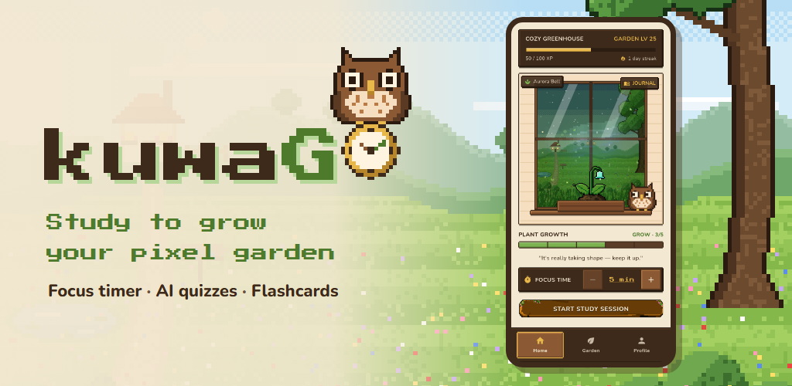
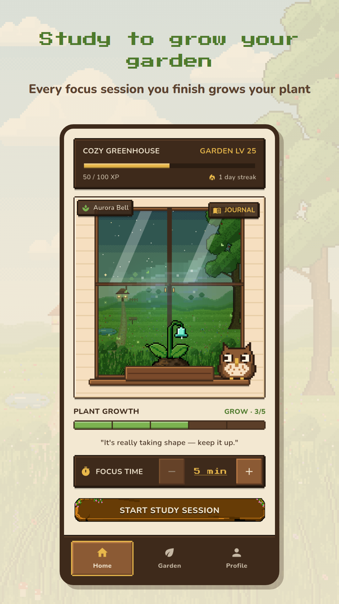
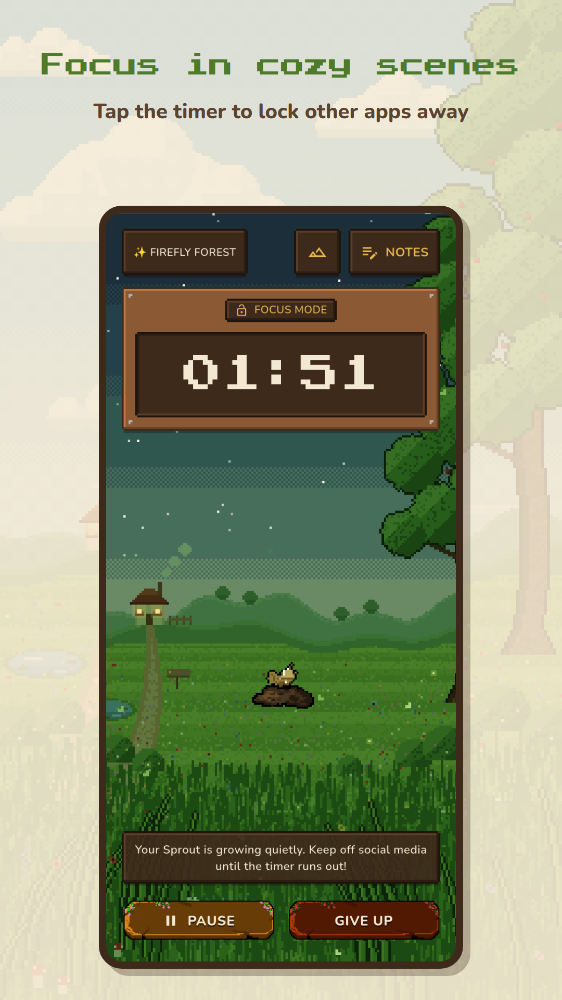
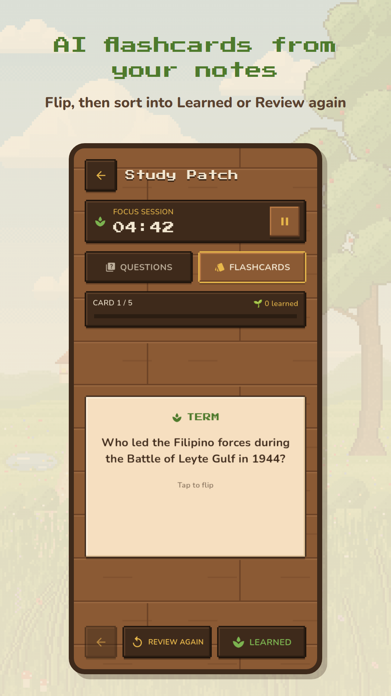
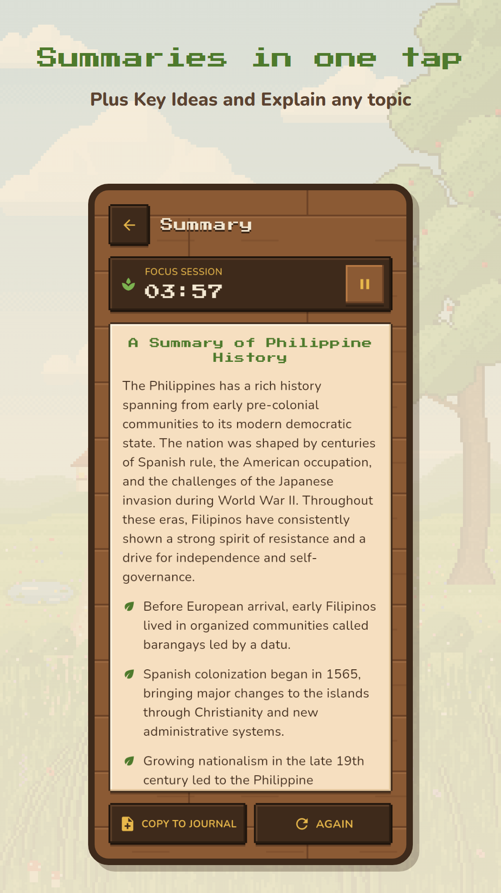
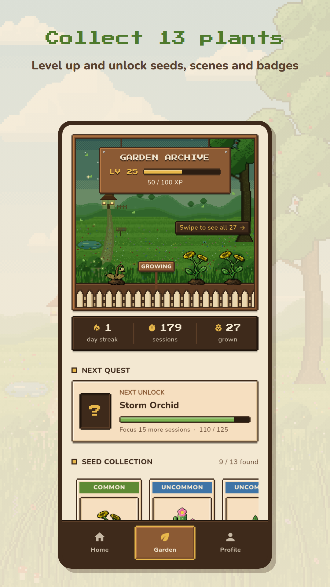
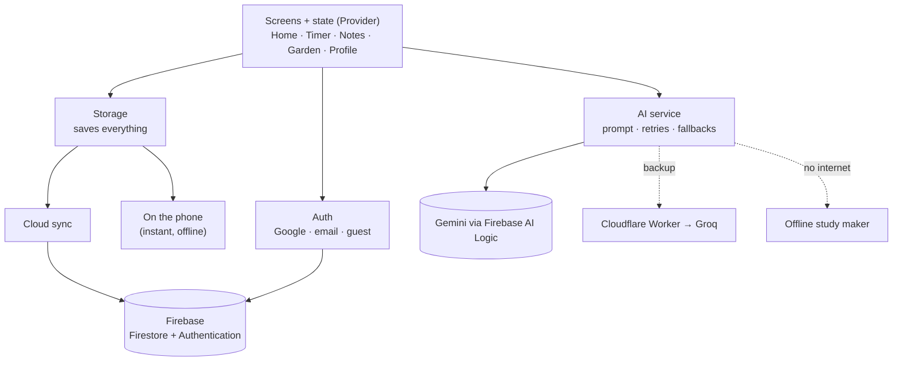

<p align="center">
  
</p>

<h1 align="center">kuwaGO</h1>

<p align="center">
  <b>A cozy pixel-art study garden — study to grow your plants.</b><br>
  Pomodoro focus timer · plant-growing game · AI quizzes, flashcards and summaries from your own notes
</p>

<p align="center">
  Flutter · Android · Firebase · Gemini
</p>

<p align="center">
  🌐 <a href="https://neckolescano.github.io/kuwaGO/">Website</a> ·
  🔒 <a href="https://neckolescano.github.io/kuwaGO/privacy.html">Privacy policy</a> ·
  🗑️ <a href="https://neckolescano.github.io/kuwaGO/delete-account.html">Delete your account</a>
</p>

<p align="center">
  
</p>

<p align="center">
  
  
  
  
  
</p>

> This repository is the **public showcase** of kuwaGO: what it does, how it
> was made, and its privacy pages. The app's source code is kept private.

---

## What is kuwaGO?

kuwaGO is an Android app for students who study with the **Pomodoro technique**.
Every focus session you finish grows a pixel plant. Give up halfway and the
plant wilts. Fully grown plants are harvested into your garden, and new seeds
unlock as you keep studying.

While you study, you can write notes. With one tap, AI turns those notes into
**quiz questions and flashcards** so you can review what you learned (active
recall), or into a **summary, key ideas, or an explanation** of any topic.

Need help staying off your phone? **Deep Focus** locks other apps away until
the session ends.

The mascot is **kuwago**, a pixel owl (*kuwago* is Filipino for "owl").

> kuwaGO started as a school project called *"Rooted: An AI-Assisted Pomodoro
> and Active Recall Mobile Application for Independent Student Learning."*
> After the course ended, I kept building it as a personal project, with the
> goal of releasing it on the Google Play Store.

## How it works

```
 Start a focus session ─► Finish it ─► Your plant grows one stage
         │                                    │
         │ give up                            ▼ (after 4 sessions)
         ▼                              Harvest it into your garden
   Plant wilts                                │
 (next session revives it)                    ▼
                                  Earn XP · level up · unlock new seeds
```

## Features

| | Feature | What it does |
|---|---|---|
| ⏱️ | **Focus timer** | Pick your focus time (5 minutes to 2 hours) and start a session. Leaving early asks if you want to give up. |
| 🔒 | **Deep Focus** | Tap the timer to pin the app: other apps are locked away until the session ends. Leave anyway and you have 10 seconds to come back before your plant wilts (calls and screen-off don't count). Finishing earns bonus XP. |
| 🌱 | **Plant growing** | 5 growth stages: seed → sprout → grow → bloom → full grown. |
| 🌻 | **13 plant species** | Unlocked by completed sessions, from the Wild Sunflower to legendary plants with glowing effects. One is secret. |
| 🏡 | **Garden** | Every plant you harvest, your stats, and your next unlock. |
| 📝 | **Study Journal** | Take notes during a session or any time. They are saved and synced. |
| 🤖 | **AI quiz** | Turns your notes into multiple choice, true/false and identification questions, one at a time with a score. Review the missed ones or practice again. |
| 🃏 | **Flashcards** | Flip a card, then sort it into *Learned* or *Review again*. At the end, review only the cards you still need. |
| 📖 | **Study Tools** | **Summary**, **Key Ideas**, and **Explain** a topic from your notes, with *Copy to journal*. |
| 📴 | **Works offline** | No internet? A built-in maker creates simpler questions, cards, summaries and key ideas from your notes. |
| 🦉 | **Guided tours** | kuwago flies around the app and shows beginners each part. |
| 📊 | **Study Log** | Past sessions by day, with this week's focus minutes. |
| 🏅 | **Progress** | XP, garden levels, badges, a daily streak, and hidden secret achievements. |
| 🎨 | **Player Card** | Profile photo, gardener name, 8 card designs and 12 garden scenes to unlock. |
| 🔔 | **Reminders** | A daily study reminder at the time you choose. |
| 👤 | **Accounts** | Sign in with Google, email, or play as a guest. Your garden syncs to the cloud, and you can delete your account any time. |

---

## How I built it

kuwaGO was built from **22 September to 21 October 2026** using
**AI-assisted development**. I designed the app in Figma, defined every
feature, screen and animation, and directed an **AI coding assistant
(Claude)** to implement them. I reviewed and tested each change on a real
device, asked for revisions until it matched my design, set up Firebase,
and ran testing with 18 users.

### 1. Idea and design
- I came up with the concept: a Pomodoro timer where studying grows a pixel
  garden, mixed with a cozy farming game and AI-powered active recall.
- I designed the screens in **Figma** (layout, colours and the cozy pixel
  style). These mockups were the starting point of the app.
- I drew the core pixel art by hand in **Piskel**.

### 2. Building it with AI assistance
- I sent my **Figma designs** to the AI to build the base of the app: the
  screens, navigation and pixel-style UI.
- For each feature and animation, I described what I was picturing. For
  example: *"the greenhouse window opens and zooms into the timer"*,
  *"the owl reacts when tapped"*, *"the plant wilts when I give up"*.
  The AI wrote the Flutter code, and often offered a few options. I chose
  one, tested it on my phone and asked for changes until it matched my vision.
- Animations made this way include the window-zoom transition, plant growth,
  the kuwago owl (blinking, flapping, hearts, flying tours, napping), the
  animated splash screen, the garden skies, harvest confetti and the glowing
  plant auras.
- Features also came from tester feedback. For example, a tester asked for a
  way to stop leaving the app mid-session, which became **Deep Focus**.

### 3. Setup and testing
- I set up **Firebase** myself: sign-in methods, the Firestore database and its
  security rules, AI Logic and App Check, plus a small Cloudflare Worker that
  keeps the backup AI's key off the phone.
- I tested every change on my own Android phone, and shared test builds with
  **18 testers** through Firebase App Distribution.
- The project has **72 automated tests**, and the code analyzer reports no issues.

### Who did what

| Part | Me | AI assistant |
|---|---|---|
| App concept, features, game rules | Decided | Suggested options |
| UI design | Designed in Figma | Built it in Flutter |
| Core pixel art (Wild Sunflower, button, harvest scroll) | Drew by hand in Piskel | — |
| Other plants, wilted versions, backgrounds, app icon | Set the style, approved results | Wrote scripts that generate them in my style |
| Animations and code-drawn art (owl, skies, confetti, auras) | Described the vision, chose and tested | Wrote the code |
| Code | Defined requirements, reviewed, tested, requested revisions | Generated the implementation from my designs and instructions |
| Firebase, AI and Cloudflare setup | Did the console setup | Gave step-by-step instructions |
| Testing | Tested on my phone with 18 testers | Wrote the automated tests |

---

## Tech stack

| Part | Technology |
|---|---|
| App | [Flutter](https://flutter.dev) (Dart), Android |
| State management | `provider` (ChangeNotifier) |
| Login | Firebase Authentication (Google, email/password, anonymous guest) |
| Database | Cloud Firestore, with an offline copy on the phone |
| AI | Gemini through **Firebase AI Logic**, with Groq (`gpt-oss`) as a backup through a Cloudflare Worker |
| Security | Firebase App Check (Play Integrity) and Firestore security rules |
| Notifications | `flutter_local_notifications` |
| Deep Focus | Android app pinning through a small Kotlin method channel |
| Art | Hand-drawn pixel art (Piskel) plus code-drawn art (`CustomPainter`) |

## How the app is built



- **Screens never talk to Firebase directly.** They go through small services.
- **No AI keys in the app.** Gemini's key stays with Firebase, and the backup
  AI's key stays in a Cloudflare Worker.
- **Each user can only read and write their own data** (Firestore security rules).

---

## Roadmap

- [x] Core loop: study → grow → harvest → garden
- [x] AI study material with offline fallback
- [x] Cloud sync, Study Log, reminders, Player Card
- [x] Guided tours, Deep Focus, flashcard deck, Study Tools, daily streak
- [x] Account deletion, privacy policy, protected AI keys
- [x] Store listing, graphics and screenshots ready
- [ ] Closed testing on Google Play
- [ ] **Google Play Store release**

---

## Author

Made by **Nicho Lescano (Necko)**.

© 2026 Nicho Lescano. All rights reserved. The kuwaGO name, artwork and app are
not licensed for reuse.
